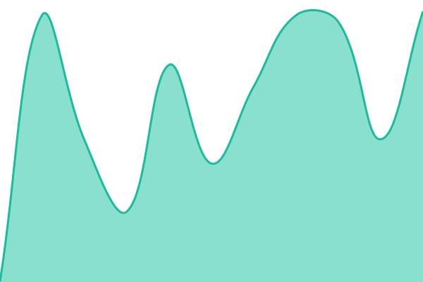

# [📈 Live Status](https://demo.upptime.js.org): <!--live status--> **🟧 Partial outage**

This repository contains the open-source uptime monitor and status page for [Upptime](https://upptime.js.org), powered by [Upptime](https://github.com/upptime/upptime).

With [Upptime](https://upptime.js.org), you can get your own unlimited and free uptime monitor and status page, powered entirely by a GitHub repository. We use [Issues](https://github.com/upptime/upptime/issues) as incident reports, [Actions](https://github.com/rifzkiadiyaksa/upptime/actions) as uptime monitors, and [Pages](https://demo.upptime.js.org) for the status page.

<!--start: status pages-->
<!-- This summary is generated by Upptime (https://github.com/upptime/upptime) -->
<!-- Do not edit this manually, your changes will be overwritten -->
<!-- prettier-ignore -->
| URL | Status | History | Response Time | Uptime |
| --- | ------ | ------- | ------------- | ------ |
|  [rifzki.my.id](https://rifzki.my.id) | 🟩 Up | [rifzki-adiyaksa.yml](https://github.com/rifzkiadiyaksa/upptime/commits/HEAD/history/rifzki-adiyaksa.yml) | 

 253ms
     
 | 

<a href="https://status.rifzki.my.id/history/rifzki-adiyaksa">100.00%</a>
    

|  [laci.rifzki.my.id](https://laci.rifzki.my.id) | 🟩 Up | [laci-rifzki-my-id.yml](https://github.com/rifzkiadiyaksa/upptime/commits/HEAD/history/laci-rifzki-my-id.yml) | 

 374ms
     
 | 

<a href="https://status.rifzki.my.id/history/laci-rifzki-my-id">100.00%</a>
    

|  [s.rifzki.my.id](https://s.rifzki.my.id) | 🟩 Up | [s-rifzki-my-id.yml](https://github.com/rifzkiadiyaksa/upptime/commits/HEAD/history/s-rifzki-my-id.yml) | 

 309ms
     
 | 

<a href="https://status.rifzki.my.id/history/s-rifzki-my-id">100.00%</a>
    

|  [ai.rifzki.my.id](https://ai.rifzki.my.id) | 🟩 Up | [ai-rifzki-my-id.yml](https://github.com/rifzkiadiyaksa/upptime/commits/HEAD/history/ai-rifzki-my-id.yml) | 

 352ms
     
 | 

<a href="https://status.rifzki.my.id/history/ai-rifzki-my-id">100.00%</a>
    

|  [blog.rifzki.my.id](https://blog.rifzki.my.id) | 🟥 Down | [blog-rifzki-adiyaksa.yml](https://github.com/rifzkiadiyaksa/upptime/commits/HEAD/history/blog-rifzki-adiyaksa.yml) | 

 399ms
     
 | 

<a href="https://status.rifzki.my.id/history/blog-rifzki-adiyaksa">59.61%</a>
    

|  [jejak.rifzki.my.id](https://jejak.rifzki.my.id) | 🟩 Up | [jejak-rifzki-my-id.yml](https://github.com/rifzkiadiyaksa/upptime/commits/HEAD/history/jejak-rifzki-my-id.yml) | 

 78ms
     
 | 

<a href="https://status.rifzki.my.id/history/jejak-rifzki-my-id">100.00%</a>
    

|  [meet.rifzki.my.id](https://meet.rifzki.my.id) | 🟩 Up | [meet-rifzki-my-id.yml](https://github.com/rifzkiadiyaksa/upptime/commits/HEAD/history/meet-rifzki-my-id.yml) | 

 356ms
     
 | 

<a href="https://status.rifzki.my.id/history/meet-rifzki-my-id">100.00%</a>
    

|  [speed.rifzki.my.id](https://speed.rifzki.my.id) | 🟩 Up | [speed-rifzki-my-id.yml](https://github.com/rifzkiadiyaksa/upptime/commits/HEAD/history/speed-rifzki-my-id.yml) | 

 223ms
     
 | 

<a href="https://status.rifzki.my.id/history/speed-rifzki-my-id">100.00%</a>
    

|  [webmail.rifzki.my.id](https://webmail.rifzki.my.id) | 🟩 Up | [webmail-rifzki-my-id.yml](https://github.com/rifzkiadiyaksa/upptime/commits/HEAD/history/webmail-rifzki-my-id.yml) | 

 219ms
     
 | 

<a href="https://status.rifzki.my.id/history/webmail-rifzki-my-id">100.00%</a>
    

|  [cpanel.rifzki.my.id](https://cpanel.rifzki.my.id) | 🟩 Up | [cpanel-rifzki-my-id.yml](https://github.com/rifzkiadiyaksa/upptime/commits/HEAD/history/cpanel-rifzki-my-id.yml) | 

 215ms
     
 | 

<a href="https://status.rifzki.my.id/history/cpanel-rifzki-my-id">100.00%</a>
    

|  [panel.rifzki.my.id](https://panel.rifzki.my.id) | 🟩 Up | [panel-rifzki-my-id.yml](https://github.com/rifzkiadiyaksa/upptime/commits/HEAD/history/panel-rifzki-my-id.yml) | 

 518ms
     
 | 

<a href="https://status.rifzki.my.id/history/panel-rifzki-my-id">100.00%</a>
    

<!--end: status pages-->

[**Visit our status website →**](https://demo.upptime.js.org)

## 📄 License

- Powered by: [Upptime](https://github.com/upptime/upptime)
- Code: [MIT](./LICENSE) © [Upptime](https://upptime.js.org)
- Data in the `./history` directory: [Open Database License](https://opendatacommons.org/licenses/odbl/1-0/)
